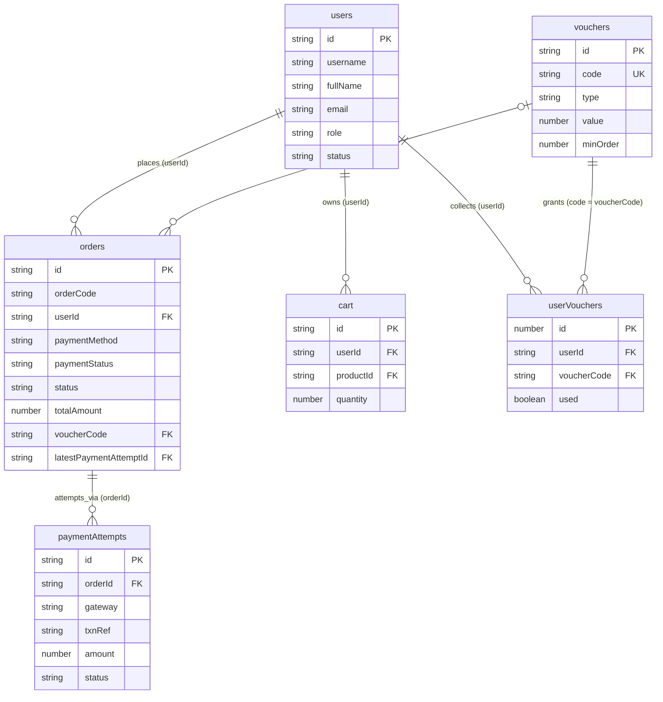

# HỒ SƠ ĐẶC TẢ CƠ SỞ DỮ LIỆU (DATABASE SPECIFICATION)
*Hệ quản trị: MongoDB NoSQL*  
*Nguồn kiểm chứng: `database/backups/db.json.bak`, `server_mongodb.mjs`, `scripts/migrate_to_mongodb.mjs`*

---

## 1. TỔNG QUAN HỆ THỐNG DỮ LIỆU
Hệ thống sử dụng MongoDB lưu trữ dữ liệu dạng BSON Document linh hoạt. Cơ sở dữ liệu bao gồm 20 collections chính. Dù MongoDB không bắt buộc ràng buộc khóa ngoại cứng ở tầng database engine, hệ thống duy trì tính toàn vẹn quan hệ thông qua mã nguồn kiểm tra tại tầng ứng dụng (`server_mongodb.mjs`).

*Quy ước phân loại quan hệ:*
* **[DIRECTLY VERIFIED]:** Quan hệ được kiểm tra và xử lý trực tiếp bằng truy vấn logic trong code (VD: `orders.userId` được đối chiếu với `users.id`, `orders.latestPaymentAttemptId` đối chiếu với `paymentAttempts.id`).
* **[INFERRED FROM CODE USAGE]:** Quan hệ được suy luận dựa trên cấu trúc trường tương đồng và logic hiển thị UI (VD: `cart.productId` tham chiếu tới `products.id`).

---

## 2. CHI TIẾT TỪ ĐIỂN DỮ LIỆU (DATA DICTIONARY)

### Phân hệ 1: Giao dịch & Bán hàng (Core Commerce)

#### 1. Bảng `users` (Quản lý Người dùng & Phân quyền)
- **Mục đích:** Lưu trữ hồ sơ định danh người dùng và xác thực quyền hạn.
- **Các trường:**
  - `id` (String / ObjectId, PK): Khóa chính định danh duy nhất. Index `{ id: 1 }`.
  - `username` (String): Tên tài khoản đăng nhập.
  - `password` (String): Mật khẩu người dùng (đã mã hóa hash).
  - `fullName` (String): Họ và tên đầy đủ của người dùng.
  - `email` (String): Địa chỉ thư điện tử liên hệ.
  - `phone` (String): Số điện thoại liên lạc.
  - `address` (String): Địa chỉ mặc định giao nhận hàng hóa.
  - `role` (String, Enum: `admin` | `user`): Vai trò truy cập hệ thống.
  - `status` (String, Enum: `active` | `blocked`): Trạng thái hoạt động tài khoản.
  - `createdAt` (String, ISO 8601): Thời điểm khởi tạo tài khoản.

#### 2. Bảng `orders` (Quản lý Đơn hàng)
- **Mục đích:** Lưu trữ toàn bộ thông tin đơn hàng, trạng thái xử lý và snapshot sản phẩm tại thời điểm mua.
- **Các trường:**
  - `id` (String, PK): Mã định danh đơn hàng hệ thống.
  - `orderCode` (String): Mã đơn hàng nghiệp vụ thân thiện với người dùng (VD: `1712...`).
  - `userId` (String, FK -> `users.id` [DIRECTLY VERIFIED]): Người thực hiện đặt đơn.
  - `fullName`, `phone`, `email`, `address` (String): Thông tin người nhận hàng lúc checkout.
  - `paymentMethod` (String, Enum: `cod` | `vnpay` | `momo`): Phương thức thanh toán được chọn.
  - `paymentStatus` (String, Enum: `unpaid` | `pending` | `paid` | `failed`): Trạng thái thanh toán.
  - `status` (String, Enum: `pending` | `confirmed` | `shipping` | `completed` | `cancelled`): Trạng thái vòng đời đơn hàng.
  - `totalAmount` (Number): Tổng số tiền thanh toán thực tế của đơn hàng.
  - `voucherCode` (String, FK -> `vouchers.code` [DIRECTLY VERIFIED]): Mã giảm giá áp dụng (nếu có).
  - `discountAmount` (Number): Số tiền được giảm trừ từ voucher.
  - `products` (Array of Objects): Danh sách snapshot các sản phẩm đã mua (chứa `productId`, `name`, `price`, `quantity`, `fromTable`).
  - `latestPaymentAttemptId` (String, FK -> `paymentAttempts.id` [DIRECTLY VERIFIED]): Phiên thanh toán gần nhất.
  - `idempotencyKey` (String): Khóa chống trùng lặp yêu cầu thanh toán (`requestId`).
  - `lookupToken` (String): Token ngẫu nhiên phục vụ tra cứu bảo mật kết quả giao dịch.
  - `createdAt`, `updatedAt` (String, ISO 8601): Thời gian tạo và cập nhật đơn hàng.

#### 3. Bảng `paymentAttempts` (Lịch sử & Phiên Thanh toán)
- **Mục đích:** Ghi nhận từng lần khởi tạo giao dịch thanh toán qua cổng VNPAY/MoMo để xử lý Idempotent, chống double-spend.
- **Các trường:**
  - `id` (String, PK): Mã định danh phiên thanh toán.
  - `orderId` (String, FK -> `orders.id` [DIRECTLY VERIFIED]): Đơn hàng được thanh toán.
  - `gateway` (String, Enum: `vnpay` | `momo`): Cổng thanh toán sử dụng.
  - `txnRef` (String): Mã tham chiếu giao dịch gửi sang cổng đối tác.
  - `amount` (Number): Số tiền yêu cầu thanh toán (đơn vị: VNĐ).
  - `status` (String, Enum: `pending` | `paid` | `failed`): Kết quả xử lý phiên.
  - `paymentUrl` (String): Đường dẫn thanh toán được sinh từ cổng đối tác.
  - `ipAddress` (String): Địa chỉ IP của máy khách gửi yêu cầu.
  - `createdAt`, `expiresAt` (String, ISO 8601): Thời gian khởi tạo và hết hạn phiên giao dịch.

#### 4. Bảng `cart` (Giỏ hàng Người dùng)
- **Mục đích:** Quản lý các mặt hàng đang được người dùng lưu trữ trong giỏ.
- **Các trường:**
  - `id` (String, PK): Mã item trong giỏ.
  - `userId` (String, FK -> `users.id` [DIRECTLY VERIFIED]): Chủ sở hữu giỏ hàng.
  - `productId` (String, FK -> `products.id` [INFERRED FROM CODE USAGE]): Mã sản phẩm.
  - `quantity` (Number): Số lượng sản phẩm thêm vào giỏ.
  - `fromTable` (String): Tên bảng dữ liệu gốc chứa sản phẩm (để tra cứu giá chính xác).

#### 5. Bảng `vouchers` & `userVouchers` (Khuyến mãi)
- **`vouchers`:**
  - `id` (String, PK): Khóa định danh voucher.
  - `code` (String, Unique Key): Mã code người dùng nhập (VD: `GIAM50K`).
  - `type` (String, Enum: `percent` | `fixed`): Giảm theo tỷ lệ phần trăm hoặc số tiền cố định.
  - `value` (Number): Giá trị chiết khấu.
  - `minOrder` (Number): Giá trị đơn hàng tối thiểu để áp dụng.
  - `maxCollect` (Number): Giới hạn số lượng người dùng tối đa được thu thập.
- **`userVouchers`:**
  - `id` (Number/String, PK): Khóa định danh liên kết.
  - `userId` (String, FK -> `users.id` [DIRECTLY VERIFIED]): Người dùng đã lưu voucher.
  - `voucherCode` (String, FK -> `vouchers.code` [DIRECTLY VERIFIED]): Mã code voucher đã lưu.
  - `used` (Boolean): Trạng thái đã sử dụng hay chưa (`true`/`false`).

---

### Phân hệ 2: Danh mục & Nội dung (Catalog & Content)

#### 6. Bảng `products` (Sản phẩm cốt lõi)
- **Mục đích:** Lưu trữ linh kiện, máy tính và các mặt hàng kinh doanh chủ lực.
- **Các trường:**
  - `id` (String, PK): Mã sản phẩm duy nhất.
  - `name` (String): Tên sản phẩm thương mại.
  - `price` (Number): Đơn giá niêm yết.
  - `image` (String): Đường dẫn URL hình ảnh đại diện.
  - `stock` (Number): Số lượng hàng khả dụng trong kho.
  - `sold` / `soldCount` (Number): Số lượng sản phẩm đã bán ra.
  - `rating` (Number): Điểm đánh giá trung bình từ khách hàng (thang 5 sao).
  - `reviewsCount` (Number): Tổng số lượt đánh giá gửi về.
  - `deleted` (Boolean): Cờ xóa mềm (Soft delete) phục vụ quản trị.

#### 7. Bảng `catenogies` & Các bảng phân loại chuyên biệt
- **`catenogies`:** Quản lý danh mục phân loại mẹ.
- **`LaptopUser`:** Danh sách sản phẩm laptop kèm thông số phân khúc người dùng (Gaming, Văn phòng, Đồ họa).
- **`eventList`:** Sản phẩm thuộc các sự kiện khuyến mãi, xả kho.
- **`appliances`:** Các mặt hàng điện máy/gia dụng công nghệ.
- **`ProductPagies`**, **`ProductMenus`**, **`demoUnits`**: Dữ liệu cấu hình giao diện động và hàng trưng bày.

#### 8. Bảng `reviews` (Đánh giá sản phẩm)
- **Các trường:** `id`, `productId` (FK -> `products.id`), `userId` (FK -> `users.id`), `userName`, `rating` (1-5), `comment`, `createdAt`.

#### 9. Bảng `news` (Tin tức & Bài viết)
- **Các trường:** `id`, `title`, `author`, `content`, `image`, `views`, `createdAt`.

---

### Phân hệ 3: Tương tác & Vận hành (Engagement & Operations)
- **`chatMessages`:** Lưu trữ phiên đối thoại RAG (`id`, `userId`, `userQuery`, `botReply`, `timestamp`).
- **`notifications`:** Thông báo gửi tới tài khoản (`id`, `userId`, `title`, `message`, `isRead`, `createdAt`).
- **`serviceRequests`:** Đơn yêu cầu bảo hành/kỹ thuật (`id`, `userId`, `productName`, `description`, `status`, `createdAt`).
- **`wishlist`:** Danh sách sản phẩm người dùng đánh dấu quan tâm (`id`, `userId`, `productId`, `addedAt`).

---

## 3. SƠ ĐỒ MÔ HÌNH THỰC THỂ LIÊN KẾT (MERMAID ERD)

### 3.1. Phân hệ Bán hàng & Giao dịch (Core Commerce Module)

