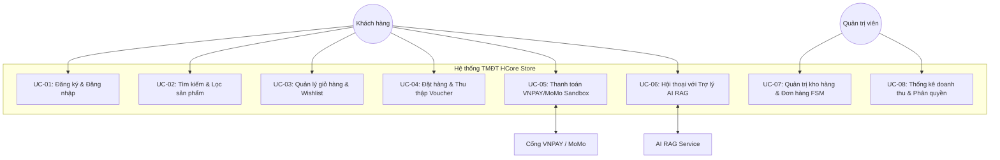

# HỒ SƠ ĐẶC TẢ TRƯỜNG HỢP SỬ DỤNG (USE CASE SPECIFICATION)
*Nguồn kiểm chứng: `src/App.jsx`, `server_mongodb.mjs`, `rag_service/`*

---

## 1. BIỂU ĐỒ TỔNG QUAN USE CASE (USE CASE DIAGRAM)

---

## 2. CHI TIẾT CÁC USE CASE TRỌNG TÂM

### UC-05: Thanh toán Đơn hàng qua Cổng VNPAY Sandbox
* **Mã Use Case:** `UC-05`
* **Tên Use Case:** Thanh toán Đơn hàng Trực tuyến qua VNPAY
* **Tác nhân chính (Actor):** Khách hàng (Customer)
* **Tác nhân hỗ trợ:** Cổng thanh toán VNPAY (Payment Gateway)
* **Tiền điều kiện (Preconditions):**
  1. Khách hàng đã đăng nhập tài khoản hợp lệ.
  2. Giỏ hàng có ít nhất một sản phẩm còn hàng trong kho (`stock > 0`).
  3. Đã điền đầy đủ thông tin giao hàng tại trang Checkout.
* **Sự kiện kích hoạt (Trigger):** Khách hàng chọn phương thức "VNPAY" và nhấn nút "Thanh toán ngay".
* **Luồng sự kiện chính (Main Flow):**
  1. Frontend React tạo mã `requestId` (UUIDv4) để chống gửi trùng và gửi yêu cầu tới `POST /api/payments/vnpay/create`.
  2. Backend Node.js kiểm tra tồn kho, khóa sản phẩm tạm thời, tạo bản ghi `orders` (trạng thái `pending`, `unpaid`), và ghi nhận phiên vào `paymentAttempts`.
  3. Backend tạo chuỗi băm HMAC-SHA512 với `VNP_HASH_SECRET`, ghép nối thành URL thanh toán VNPAY và trả về cho Frontend.
  4. Trình duyệt khách hàng chuyển hướng sang cổng thanh toán VNPAY Sandbox.
  5. Khách hàng nhập thông tin thẻ test của VNPAY và nhập mã OTP xác nhận.
  6. VNPAY xử lý trừ tiền thành công trên môi trường Sandbox.
  7. VNPAY gửi tín hiệu ngầm Server-to-Server tới Webhook `GET /api/payments/vnpay/ipn`.
  8. Backend HCore xác thực chữ ký số của IPN, đối soát `paymentAttempts`, cập nhật `orders.paymentStatus = 'paid'` và xóa giỏ hàng tương ứng.
  9. VNPAY chuyển hướng trình duyệt của khách hàng về `GET /api/payments/vnpay/return`.
  10. Backend điều hướng khách hàng về trang Frontend `/payment-result` hiển thị thông báo "Thanh toán thành công" kèm mã đơn hàng.
* **Luồng thay thế (Alternative Flow):**
  - Khách hàng hủy giao dịch tại cổng VNPAY: VNPAY trả mã phản hồi khác `00` về trang return. Hệ thống hiển thị trạng thái thanh toán thất bại kèm nút "Thử lại thanh toán" (`POST /api/orders/:orderId/vnpay/retry`).
* **Luồng ngoại lệ (Exception Flow):**
  - Mất kết nối mạng hoặc sai lệch chữ ký bảo mật: Backend trả về lỗi `{ RspCode: "97", Message: "Checksum failed" }`, đơn hàng giữ nguyên trạng thái `unpaid` để tránh gian lận.
* **Hậu điều kiện (Postconditions):** Đơn hàng chuyển sang `paid`, kho hàng được trừ, giỏ hàng được dọn sạch.
* **Giao diện liên quan:** `Checkout.jsx`, `PaymentResult.jsx`.
* **API liên quan:** `POST /api/payments/vnpay/create`, `GET /api/payments/vnpay/ipn`, `GET /api/payments/vnpay/return`.
* **Bảng CSDL liên quan:** `orders`, `paymentAttempts`, `cart`, `products`.

---

### UC-06: Tư vấn Sản phẩm qua Trợ lý Ảo AI RAG
* **Mã Use Case:** `UC-06`
* **Tên Use Case:** Tư vấn mua sắm bằng AI RAG Chatbot
* **Tác nhân chính:** Khách hàng (hoặc Khách vãng lai)
* **Tác nhân hỗ trợ:** Dịch vụ AI (FastAPI + FastEmbed + Google Gemini)
* **Tiền điều kiện:** Widget Chatbot đang hiển thị trên giao diện người dùng.
* **Sự kiện kích hoạt:** Người dùng nhập câu hỏi vào ô chat và nhấn "Gửi".
* **Luồng sự kiện chính:**
  1. Frontend gửi câu hỏi qua API `POST /api/chat` tới máy chủ FastAPI (Port 8000).
  2. Hệ thống chuyển câu hỏi qua bộ 3 lớp phòng vệ `guards.py`:
     - Kiểm tra rò rỉ dữ liệu nhạy cảm cá nhân (PII Guard).
     - Kiểm tra hành vi tấn công chiếm quyền / bẻ khóa câu lệnh (Jailbreak Guard).
     - Kiểm tra nội dung nằm ngoài lĩnh vực công nghệ (Off-topic Filter).
  3. Mô hình FastEmbed (`bge-small-en-v1.5`) chuyển đổi câu hỏi thành Vector đặc trưng 384 chiều.
  4. Module Retriever tính toán khoảng cách Cosine Similarity, trích xuất Top-K sản phẩm phù hợp nhất từ cơ sở dữ liệu.
  5. Hệ thống ghép nối thông tin sản phẩm thu được vào System Prompt mẫu.
  6. Gửi Prompt tổng hợp tới mô hình Google Gemini Flash (`gemini-2.5-flash`).
  7. Gemini sinh câu trả lời tư vấn tự nhiên, kèm thông số và giá bán chính xác.
  8. Frontend nhận phản hồi và render tin nhắn dạng hội thoại cho người dùng.
* **Luồng thay thế (Alternative Flow):**
  - Câu hỏi bị bộ lọc bảo mật chặn: AI trả lời ngay thông điệp nhắc nhở thân thiện mà không gọi LLM để tiết kiệm chi phí.
  - Mất kết nối internet hoặc hết quota Gemini: Hệ thống tự động kích hoạt `build_offline_fallback_reply` ghép các thông tin sản phẩm tìm thấy theo khuôn mẫu cố định gửi về cho khách.
* **Giao diện liên quan:** `ChatBot.jsx`.
* **API liên quan:** `POST /api/chat`.
* **Bảng CSDL liên quan:** `products`, `chatMessages`.

---

### UC-07: Quản trị Vòng đời Đơn hàng theo Máy trạng thái (FSM)
* **Mã Use Case:** `UC-07`
* **Tên Use Case:** Xử lý và Chuyển trạng thái Đơn hàng
* **Tác nhân chính:** Quản trị viên (Admin)
* **Tiền điều kiện:** Quản trị viên đăng nhập với tài khoản có `role === 'admin'`.
* **Luồng chính:**
  1. Admin mở trang Quản lý đơn hàng `/admin/orders`.
  2. Hệ thống gọi `GET /api/admin/orders` hiển thị danh sách đơn kèm bộ lọc.
  3. Admin chọn một đơn hàng và đổi trạng thái mới (VD: từ `pending` sang `confirmed`).
  4. Backend kiểm tra tính hợp lệ của bước chuyển dựa trên ma trận chuyển đổi:
     - `pending -> confirmed | cancelled`
     - `confirmed -> shipping | cancelled`
     - `shipping -> completed`
  5. Nếu hợp lệ, hệ thống cập nhật `orders.status` và trả về kết quả thành công.
* **Luồng ngoại lệ:**
  - Admin cố duyệt đơn hàng VNPAY sang `shipping` khi khách chưa thanh toán: Backend chặn lại với mã lỗi HTTP 409 "Đơn VNPAY chưa thanh toán nên chưa thể giao hàng".
