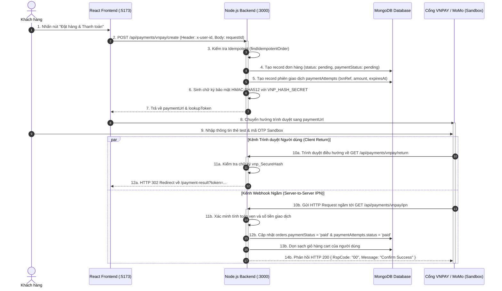
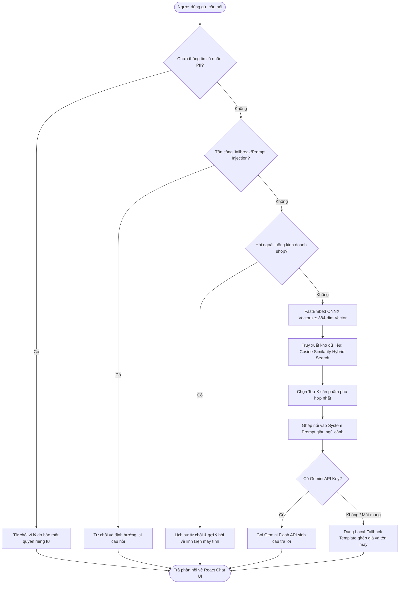
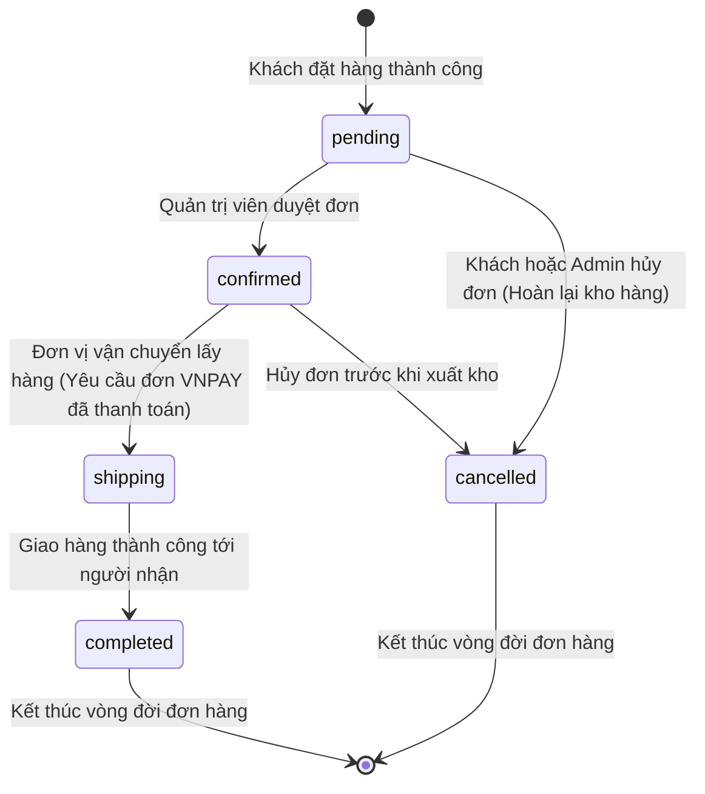

# HỒ SƠ ĐẶC TẢ LUỒNG CÔNG VIỆC & NGHIỆP VỤ (WORKFLOW SPECIFICATION)
*Nguồn kiểm chứng: `server_mongodb.mjs`, `backend/vnpay.mjs`, `backend/momo.mjs`, `rag_service/engine.py`*

---

## 1. LUỒNG CHECKOUT & THANH TOÁN QUA CỔNG ĐIỆN TỬ (PAYMENT WORKFLOW)

### 1.1. Sơ đồ Tuần tự (Sequence Diagram) - VNPAY / MoMo Checkout

---

## 2. LUỒNG TƯ VẤN THÔNG MINH TRỢ LÝ ẢO AI (RAG PIPELINE WORKFLOW)

### 2.1. Sơ đồ Luồng Hoạt động (Flowchart)

---

## 3. MÁY TRẠNG THÁI HỮU HẠN ĐƠN HÀNG (ORDER STATUS FINITE STATE MACHINE)

